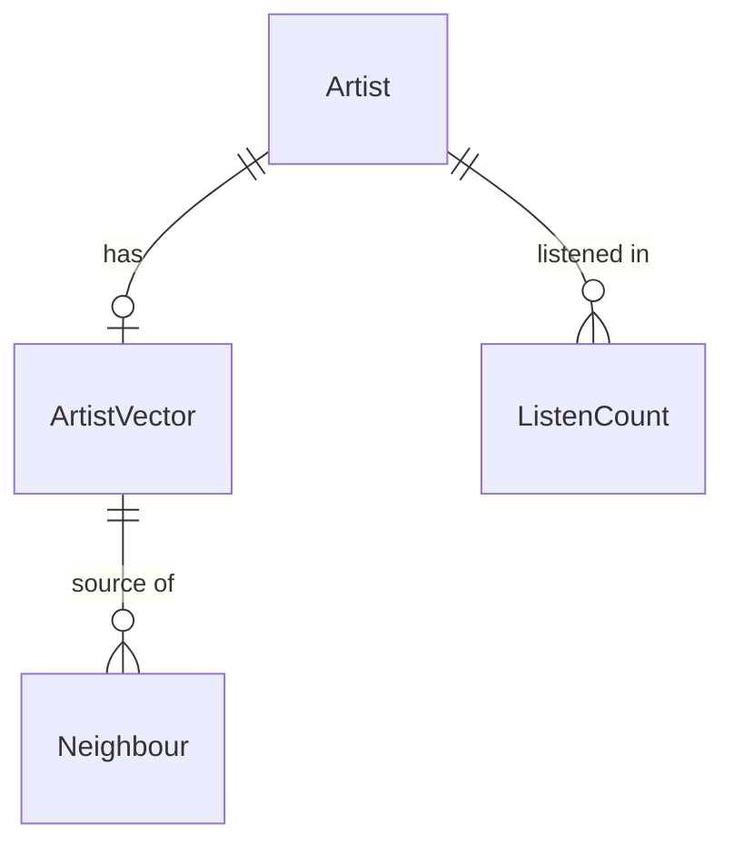

# Functional Specification — u1-skeleton

u1-skeleton implements its share of US2.1, US4.1, US4.2 and US4.4 from `inception/user-stories/stories.md` (mapping in `inception/units-generation/unit-of-work-story-map.md`; unit in `inception/units-generation/unit-of-work.md`). It satisfies the contracts in `inception/contract-design/contract-summary.md`, the components in `inception/domain-design/components.md` and the requirements in `inception/requirements-analysis/requirements.md`. Entities are in `entities.md` and rules in `rules.md`.

## Workflow W1: Build the skeleton files

1. Owner runs the prepare step with the data-location setting.
2. DumpSource checks the setting and the listening dump file (BR1.1) and opens it read-only (BR1.2).
3. ListeningDataPrep reads the first 5,000 listener lines (BR1.3), skips bad entries (BR1.5), and writes anonymous listen counts plus artist names to the git-ignored data folder (BR1.4, BR6.1).
4. Owner runs the train step: SimilarityTraining learns one vector per artist (BR2.1).
5. Owner runs the index step: ArtistCatalog writes the artist file (names, listener counts; empty descriptions and genres), SimilarityIndex writes the normalised index and id list, and the manifest is written last (BR4.1).

Error paths: a missing setting or file stops at step 2 with a named message. An earlier step's output missing stops the later step with a message naming that step. An interrupted run leaves no manifest.

## Workflow W2: Answer a similar-artists request

1. Owner starts the app with one command (BR4.3). Startup checks the built files and manifest (BR4.2).
2. A client calls the similar-artists endpoint with an artist id.
3. WebApp asks SimilarityIndex for ranked neighbours (BR3.1), then ArtistCatalog for their names.
4. WebApp returns artist, neighbours, cosine scores and paging flag (BR5.1), with no listener data (BR5.2).

Error paths: unknown id → 404 (BR3.2). An artist with no neighbours → an empty list.

## State: build files

| State | Event | Next state |
|-------|-------|-----------|
| none | prepare done | prepared |
| prepared | train done | trained |
| trained | index + manifest written | ready |
| any | step interrupted | previous state (no manifest) |

The app starts only from `ready`.

## Entity Relationships (derived from entities.md)

<!-- Text fallback: an Artist has at most one ArtistVector; an ArtistVector is the source of many Neighbours; an Artist appears in many ListenCounts. -->

## Rules Summary (derived from rules.md)

Read-only dumps and a 5,000-line sample; anonymous counts; cosine ranking without self; atomic files with the manifest last; startup checks; endpoint with names and scores; no listener data; data and models outside git.
