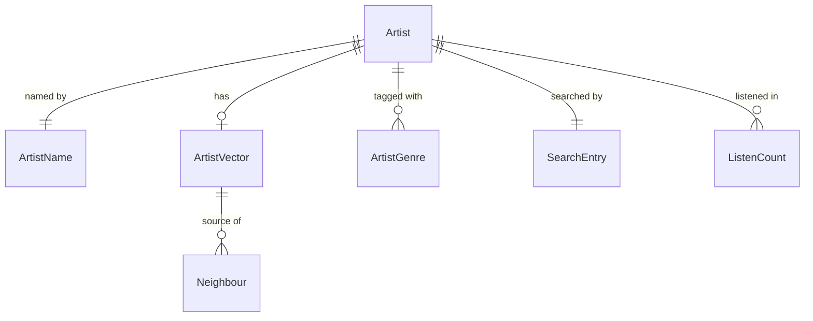

# Functional Specification — u2-pipeline

u2-pipeline implements its share of US1.1, US1.2, US4.1, US4.2 and US4.3 from `inception/user-stories/stories.md` (mapping in `inception/units-generation/unit-of-work-story-map.md`; unit in `inception/units-generation/unit-of-work.md`). US1.1 and US1.2 are shared with u3-web, which shows the suggestions; US4.1 and US4.2 are shared with u1-skeleton, which built the sample-sized path. It satisfies the contracts in `inception/contract-design/contract-summary.md` (C1 interfaces are filled in, C2 file layout is unchanged at format version 1), the components in `inception/domain-design/components.md` and the requirements in `inception/requirements-analysis/requirements.md`. Entities are in `entities.md` and rules in `rules.md`. Choices are in `functional-design-questions.md`.

This is a library unit: the work is four pipeline commands and the catalogue and index code the web app calls. It has no screens, so there is no `frontend-components.md`.

## Change from the skeleton

The skeleton's index step wrote the artist file as well as the index. Here the artist file is written by its own catalogue step, so the index step can check that every indexed artist is in the catalogue (BR5.2) and the manifest stays last (BR6.6). File names and the C2 layout do not change; the web app sees no difference.

## Workflow W1: Prepare (US4.1)

1. Owner runs the prepare step; DumpSource checks the setting and the listening dump (BR1.1) and opens it read-only (BR1.2).
2. ListeningDataPrep reads every line. A malformed line is skipped and counted (BR1.3); in a valid line, entries with no artist id or a count below 1 are skipped and counted (BR1.4).
3. Repeats for one listener and artist are added together (BR1.6).
4. Artists with fewer than 5 distinct listeners are dropped (BR1.7).
5. For each kept artist the most used name is chosen (BR3.2).
6. It writes the anonymous listen counts and the artist names (BR1.5) to the git-ignored data folder (BR1.9), then the PrepReport (BR1.8) and the prepare marker.

Error paths: a missing setting or file stops at step 1 and writes nothing. A dump with no valid line stops with a message and no marker.

## Workflow W2: Train (US4.2)

1. The train step checks the prepare marker (BR6.3, BR6.4).
2. SimilarityTraining reads the prepared counts only (BR2.4) and trains with the settings in BR2.2, inside the memory setting of BR2.3.
3. It writes one vector per kept artist, dropping and counting zero-length vectors (BR2.1), then the train marker.

Error paths: out of memory stops with a message naming the memory setting. No partial vectors are left (BR6.1).

## Workflow W3: Catalogue (US1.2, FR3.1)

1. The catalogue step checks the prepare marker and the MusicBrainz tables (BR1.1, BR6.3, BR6.4).
2. For every kept artist it builds the Artist (BR3.1): description from MusicBrainz (BR3.3), genres from recognised tags (BR3.4), listener count from the prepared counts, name from W1.
3. An artist with no MusicBrainz record is kept with no description and no genres (BR3.5).
4. It builds the search table over normalised names (BR4.8, BR4.1) and writes `artists.sqlite` (BR6.1), then the catalogue marker.

## Workflow W4: Index and speed check (NFR1)

1. The index step checks the train and catalogue markers and that both come from the same prepare run (BR6.3, BR6.4).
2. It reads the vectors in batches (BR5.4), scales them and builds the exact index (BR5.1), writes the id file, and checks the ids against the catalogue (BR5.2).
3. It writes the manifest last (BR6.6) and the index marker.
4. Separately, the owner runs the speed check on the full-size files: 100 different artists, timed for similar artists and suggestions, 95th percentile under 200 ms (BR5.3). It prints the numbers and is not part of the default test run.

## Workflow W5: Suggest artists by name (US1.1, US1.2)

1. The caller passes the typed text and a limit.
2. The text is normalised (BR4.1); no words means an empty list (BR4.2).
3. Artists where every typed word starts a name word are found (BR4.3).
4. They are ordered by tier, then listeners, then name, then id (BR4.4) and cut to at most 10 (BR4.5).
5. Each result is an ArtistSummary with the genres in rank order and the description when it has one (BR4.6). No match gives an empty list (BR4.7).

The "No artists match" wording and the one-genre display belong to u3-web.

## Workflow W6: Neighbours (C1)

SimilarityIndex returns ranked neighbours without the artist itself (BR5.1); an unknown id raises UnknownArtist and an artist with no neighbours gets an empty list (BR5.5). The paging and shape are the C1 interface from the skeleton.

## State: build files

| State | Event | Next state |
|-------|-------|-----------|
| none | prepare done | prepared |
| prepared | train done | trained |
| trained | catalogue done | catalogued |
| catalogued | index and manifest written | ready |
| any later state | prepare run again | prepared (later markers are stale and refused by BR6.4) |
| any | step interrupted | previous state (no manifest if the index step was open) |

The app starts only from `ready`.

## Entity Relationships (derived from entities.md)

<!-- Text fallback: an Artist has one ArtistName and one SearchEntry, at most one ArtistVector, many ArtistGenres and many ListenCounts; an ArtistVector is the source of many Neighbours. -->

## Rules Summary (derived from rules.md)

Dumps are read-only and checked first; bad lines and entries are skipped and counted; listener data is reduced to number, artist and count; artists need 5 listeners; training uses the current app's settings within memory; every artist keeps its details even without MusicBrainz; search ignores case and accents and ranks in four tiers then by listeners; the index is exact cosine and fast enough; steps run in a fixed order with clear missing and stale input messages; files are written whole and the manifest last; the steps are documented in the README.
