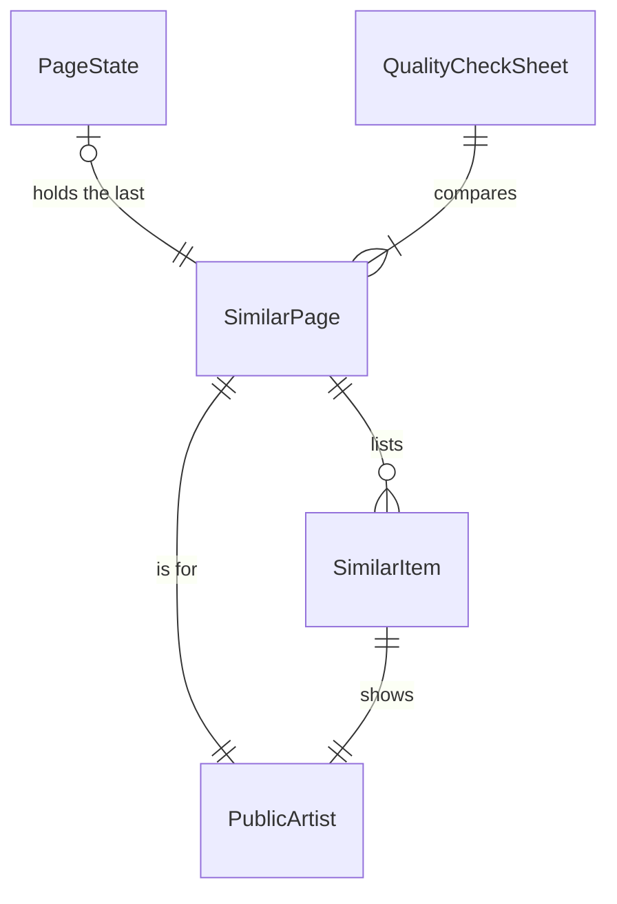

# Functional Specification — u3-web

u3-web implements its share of US1.1, US1.2, US2.1, US2.2, US2.3, US2.4, US3.1, US3.2 and US5.1 from `inception/user-stories/stories.md` (mapping in `inception/units-generation/unit-of-work-story-map.md`; unit in `inception/units-generation/unit-of-work.md`). US1.1 and US1.2 are shared with u2-pipeline, which built the name search; US2.1 is shared with u1-skeleton, which built the similar-artists endpoint. It satisfies contracts C1 and C3 in `inception/contract-design/contract-summary.md`, the components in `inception/domain-design/components.md` and the requirements in `inception/requirements-analysis/requirements.md`, and follows `inception/refined-mockups/` for every screen. Entities are in `entities.md`, rules in `rules.md`, choices in `functional-design-questions.md`.

u3-web is a service unit that serves its own page, so the page's components are specified here. A separate `frontend-components.md` is not produced because this unit's kind is service.

## Components of the page

```
Page (h1, intro, live region)
├── ArtistSearch (label "Artist", combobox, clear button)
│   └── SuggestionList (listbox of Suggestion rows, or the no-match message)
└── ResultsPanel (h2 "Artists like <name>")
    ├── StatusMessage (not-enough-data | unknown | error + Retry)
    ├── PlaceholderRows (5, while loading)
    ├── ResultsList (ordered list)
    │   └── ResultRow × n (rank, name button, bar, genres, three links)
    └── ShowMoreButton
```

The page is plain HTML, CSS and JavaScript files served by the web app. Styling uses the tokens in `inception/refined-mockups/design-system-mapping.md`.

## Workflow W1: Suggest artists as the user types (US1.1, US1.2)

1. The page loads with the search box focused (BR4.1).
2. The user types; 150 ms after the last keystroke the page asks `GET /api/suggest?q=<text>` (BR4.2). Blank text closes the list and asks nothing.
3. The endpoint refuses text over 200 characters (BR1.2) and otherwise returns up to 10 artists in the catalogue's order (BR1.1), each with name, description, genres and id (BR1.3).
4. The page shows the newest reply only (BR4.2): each row has the name, then the description and first genre (BR4.5); an empty list shows "No artists match '<text>'" (BR4.3).
5. Down and Up move the highlight, Enter picks, Escape closes (BR4.4); a click picks too.

Error path: a failed suggestion request closes the list quietly; the user can keep typing, and results already on screen are unaffected.

## Workflow W2: Show similar artists (US2.1, US3.1, US3.2)

1. A pick, a click on a result's name, or an address `/artist/<id>` starts a load. A pick or click pushes `/artist/<id>` onto the history (BR4.6); an address on arrival or a Back and Forward does not push.
2. The panel shows five placeholder rows (BR4.9) and the page asks `GET /api/artists/<id>/similar?offset=0&limit=20`.
3. The endpoint asks the index for the page (BR2.1), looks up the artist and the neighbours in the catalogue (BR1.3), scales each bar against the artist's top score (BR2.2) and adds the three links (BR2.4).
4. The page lists the rows (BR4.7) under "Artists like <name>" and moves focus to that heading after a pick.

Error paths:
- The index does not know the id but the catalogue does: the endpoint answers with the artist and no items, and the page shows "Not enough listening data to find artists like <name>." (BR2.3, BR4.9).
- Neither knows the id: 404, and the page shows "We don't know this artist." (BR2.5, BR4.9). A malformed id in the address does the same: the page route serves the page (BR3.1) and the endpoint answers 422, which the page also shows as "We don't know this artist." because a malformed address names no known artist.
- Any other failure: "Something went wrong finding similar artists. Try again." with a Retry button that repeats the request once per click (BR4.9).

## Workflow W3: Show more (US2.2)

1. The user clicks Show more; if a request is already in flight the click is ignored (BR4.8).
2. The page asks for the next page with offset equal to the rows shown, appends the rows, moves focus to the first new row and announces them politely.
3. When the reply has no more, the button is removed; the address never changes.

Error path: a failed Show more shows the plain error message with Retry beside the existing rows, which stay.

## Workflow W4: Quality check against the current app (US5.1)

1. The owner runs the generate command with up to 5 artist names (BR5.1). It writes a markdown sheet listing the new app's top 20 for each, with a verdict line left unset (BR5.3).
2. The owner runs the current app for the same artists, compares by eye and marks each artist better-or-equal or worse in the sheet.
3. The owner runs the verdict command; it prints the count and pass (at least 4 of 5), fail, or incomplete when any verdict is unset (BR5.2).

Error path: a name that matches nothing, or more than 5 artists, stops the generate command with a message.

## State: page

| State | Event | Next state |
|-------|-------|-----------|
| start | pick or address with an id | loading |
| loading | results with items | populated |
| loading | results with no items | not-enough-data |
| loading | 404 or 422 | unknown |
| loading | other failure | error |
| error | Retry | loading |
| populated | Show more | populated (rows appended; error shows beside the rows on failure) |
| any | pick or click on a name | loading (new artist, new history entry) |
| any | Back or Forward | loading (artist from the address) |

## Entity Relationships (derived from entities.md)


<!-- Text fallback: a SimilarPage is for one PublicArtist and lists many SimilarItems, each showing one PublicArtist; PageState holds the last SimilarPage; a QualityCheckSheet compares one to five SimilarPages. -->

## Rules Summary (derived from rules.md)

One suggestion endpoint that passes the catalogue's order through, with a text limit and no listener data; similar artists 20 at a time with a bar scaled to the top score; an artist missing from the index has too little data while an unknown id is 404; one page for both addresses that loads nothing from other sites and shows text only; focus on load, 150 ms delayed suggestions where only the newest reply counts, keyboard use, history entries for picks, plain messages for every state, a Retry button, a phone-sized layout; a sheet-and-verdict pair for the quality check.
