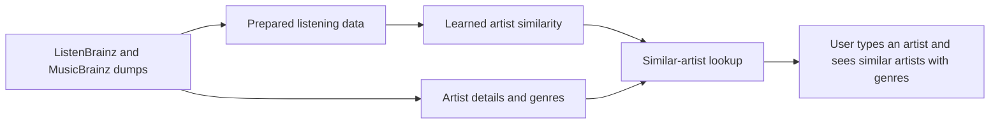

# Scope Document — Artist Recommendation App Rebuild

Inputs: the intent statement (`ideation/intent-capture/intent-statement.md`), the feasibility assessment (`ideation/feasibility/feasibility-assessment.md`), the constraint register (`ideation/feasibility/constraint-register.md`) and the answers in `scope-definition-questions.md`.

## Minimum Viable Scope

The core first version answers one need: **type in an artist and get similar artists, with their genres, quickly**. This is what the users come for (intent statement). Everything else is stretch, to keep the mvp small (Q2). The feasibility assessment rated that risk medium.

## In Scope (core, must-have)

| Capability | Why | Source |
|-----------|-----|--------|
| Prepare the listening data from the dumps already in `../listenbrainz`, read in place | Everything else is built on it | Constraint register TC-2 |
| Learn which artists are similar from listening patterns | The core of the recommender | Intent statement |
| Artist details with MusicBrainz genre tags | Genres are shown with every result | Q4 |
| Find an artist by name | Users start by typing an artist | Intent statement |
| Show similar artists for the chosen artist, in under 200 ms on the owner's machine | The main user need, with its speed target | Intent statement; constraint register TC-4 |
| A pipeline you can re-run on a new dump: a few steps in a documented order | A stated reason for the rebuild | Q1 |
| A by-eye quality check: compare a few result lists with the current app | The core way to check quality | Q7 |

## Stretch (could-have, only after the core works)

| Capability | Note | Source |
|-----------|------|--------|
| Visual map of how artists relate | Stretch | Q2 |
| Experiment and evaluation tools: genre reranking, and scoring result lists against the hand-labelled judgments | Stretch; when built, used by the owner and the friends inside the web app | Q2, Q3 |

## Out of Scope (won't have in the first version)

| Item | Source |
|------|--------|
| Public hosting or cloud deployment | Intent statement |
| Any preparation for deployment (packaging, deployment settings) | Q6 |
| User accounts or sign-in | Intent statement |
| Showing anything about individual ListenBrainz listeners | Constraint register RC-1 |
| Paid services of any kind | Constraint register OC-3 |

## Changes to the Intent's Success Metrics

The intent statement's metrics are adjusted by the answers above:

- **Feature parity** now covers the core capabilities only. The map and the experiment tools join it only if they are built as stretch (Q2).
- **Recommendation quality** is checked by eye in the core first version, by comparing a few result lists with the current app (Q7). The scored comparison against the hand-labelled judgments moves to stretch, with the evaluation tools.
- **Lookup speed** (under 200 ms) and **finishing a full AI-DLC run** are unchanged.

## Sequencing

Build in dependency order (Q5): data preparation, then learning similarity, then artist details and genres, then name search and similar-artist lookup, then the web screens, then the re-run runbook. Stretch items follow. See `intent-backlog.md`.

## Value Stream

<!-- Text fallback: the dumps become prepared listening data, which teaches artist similarity; the dumps also give artist details and genres; similarity and details together power the lookup that lets a user type an artist and see similar artists with genres. -->

## Assumptions & Open Questions

- [assumption] How the friends reach the first version is still undecided (from Intent Capture); for now only the owner uses it.
- The by-eye quality check has no pass bar yet; Requirements Analysis should say how many lists are compared and what counts as "at least as good".
