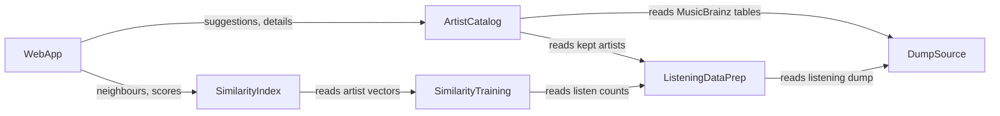

# Component Catalogue

Sources: `inception/requirements-analysis/requirements.md` (FR/NFR IDs), `inception/user-stories/stories.md` (US IDs), `inception/practices-discovery/team-practices.md`, and `domain-design-questions.md` (Q1 to Q3). Deployment topology and technology choices are left to later stages. ADRs are in `decisions.md`.

```yaml
components:
  - name: DumpSource
    summary: Locates and validates the ListenBrainz and MusicBrainz dumps and gives read-only access to them
    behaviour: >
      Reads the data location from one setting. Checks that every expected dump file exists before
      anything else runs, and fails with a message naming the setting and the missing file. Opens
      dump files read-only; it never writes, moves or modifies them (hard rule, FR1.1).
    responsibilities:
      - Resolve the data location setting
      - Validate that the expected dump files are present
      - Provide read-only access to dump files
    depends_on: []
    dependents:
      - component: ListeningDataPrep
        interaction: reads the ListenBrainz statistics dump
      - component: ArtistCatalog
        interaction: reads the MusicBrainz artist, tag and genre tables
    external_dependencies:
      - name: ListenBrainz statistics dump (in ../listenbrainz)
        kind: other
        purpose: source of listener-artist listen counts
      - name: MusicBrainz database dump (in ../listenbrainz/data/musicbrainz)
        kind: other
        purpose: source of artist names, descriptions and genres
    entities:
      - name: DumpLocation
        identifier: path
        attributes: [path, listenbrainzFiles, musicbrainzFiles]

  - name: ListeningDataPrep
    summary: Turns the ListenBrainz dump into anonymous listener-artist listen counts
    behaviour: >
      Replaces listener names with internal numbers and keeps nothing else about listeners (FR1.2,
      NFR3). Skips and counts malformed records while processing every valid one (FR1.3). Keeps only
      artists with at least 5 listeners (FR1.4). Writes its output outside git (NFR5).
    responsibilities:
      - Parse the listening dump
      - Anonymise listeners
      - Apply the 5-listener cutoff
      - Report skipped records
    depends_on:
      - component: DumpSource
        interaction: read the ListenBrainz statistics dump
        style: sync
    dependents:
      - component: SimilarityTraining
        interaction: reads prepared listen counts
      - component: ArtistCatalog
        interaction: reads which artists were kept and their listener counts
    external_dependencies: []
    entities:
      - name: ListenCount
        identifier: listenerNumber + artistMbid
        attributes: [listenerNumber, artistMbid, listenCount]
      - name: PrepReport
        identifier: runTimestamp
        attributes: [runTimestamp, validRecords, skippedRecords, keptArtists]

  - name: SimilarityTraining
    summary: Learns one vector per kept artist from the listen counts with collaborative filtering
    behaviour: >
      Uses the same collaborative-filtering approach as the current app (FR2.1). Must fit in the
      memory of the owner's 32 to 64 GB machine; any duration is acceptable (FR2.2). Can be re-run
      without re-reading the dump.
    responsibilities:
      - Train the collaborative-filtering model
      - Produce one vector per kept artist
    depends_on:
      - component: ListeningDataPrep
        interaction: read prepared listen counts
        style: sync
    dependents:
      - component: SimilarityIndex
        interaction: reads artist vectors
    external_dependencies: []
    entities:
      - name: ArtistVector
        identifier: artistMbid
        attributes: [artistMbid, vector]

  - name: ArtistCatalog
    summary: Owns everything the app shows about an artist, and finds artists by name
    behaviour: >
      Stores name, MusicBrainz id, short description, listener count and genre tags for every kept
      artist (FR3.1); an artist with no genres is shown as "no genres listed" (FR3.2). Answers name
      searches ignoring case and accents, closest text match first then by listener count, with
      the description shown to tell same-name artists apart (FR4.1 to FR4.5).
    responsibilities:
      - Build artist details from the MusicBrainz dump and the kept artists
      - Look up artist details by id
      - Suggest artists for typed text
    depends_on:
      - component: DumpSource
        interaction: read MusicBrainz artist, tag and genre tables
        style: sync
      - component: ListeningDataPrep
        interaction: read kept artists and listener counts
        style: sync
    dependents:
      - component: WebApp
        interaction: name suggestions and artist details for results
    external_dependencies: []
    entities:
      - name: Artist
        identifier: mbid
        attributes: [mbid, name, description, listenerCount, genres]

  - name: SimilarityIndex
    summary: Finds the nearest artists to a given artist by cosine similarity of their vectors
    behaviour: >
      Built from the artist vectors. Given an artist id, returns neighbour ids with cosine scores,
      most similar first, excluding the artist itself, with paging for "Show more" and no cap
      (FR5.1, FR5.4). Knows nothing about names or genres (Q3). Answers in under 200 ms at the
      95th percentile on the owner's machine (NFR1). Reports an artist with no neighbours or an
      unknown id distinctly (FR5.7, FR5.8).
    responsibilities:
      - Build the nearest-neighbour index
      - Return ranked neighbours with cosine scores
    depends_on:
      - component: SimilarityTraining
        interaction: read artist vectors
        style: sync
    dependents:
      - component: WebApp
        interaction: neighbour ids and scores for a chosen artist
    external_dependencies: []
    entities:
      - name: Neighbour
        identifier: sourceMbid + neighbourMbid
        attributes: [sourceMbid, neighbourMbid, cosine, rank]
        references:
          - entity: ArtistVector
            owned_by: SimilarityTraining
            relationship: each Neighbour pairs two artists that have vectors

  - name: WebApp
    summary: The one-page site and its endpoints for suggestions and similar artists
    behaviour: >
      Serves the page at / and /artist/<mbid> (FR5.6). Combines neighbour ids and scores from the
      index with details from the catalogue (Q3), scales the bar to the top score and keeps the raw
      cosine for hover and screen readers (FR5.3), builds MusicBrainz, YouTube search and Spotify
      search links (FR5.2 as changed in Refined Mockups). Shows the no-match, not-enough-data,
      unknown-artist and error messages (FR5.7, FR5.8, FR6.5). Never returns listener data (FR5.9).
      Starts with one command and fails at startup naming any missing built file (NFR2).
    responsibilities:
      - Serve the page and its addresses
      - Suggestion and similar-artist endpoints
      - Compose results and external links
      - Startup checks
    depends_on:
      - component: ArtistCatalog
        interaction: suggestions and artist details
        style: sync
      - component: SimilarityIndex
        interaction: ranked neighbours with scores
        style: sync
    dependents: []
    external_dependencies:
      - name: MusicBrainz, YouTube and Spotify websites
        kind: third-party-api
        purpose: outbound links only; the app never calls them
    entities: []
```

## Component Diagram


<!-- Text fallback: DumpSource is read by ListeningDataPrep and ArtistCatalog. ArtistCatalog also reads ListeningDataPrep. SimilarityTraining reads ListeningDataPrep; SimilarityIndex reads SimilarityTraining. WebApp calls ArtistCatalog and SimilarityIndex. -->

## Component Summary

| Component | Purpose | Depends On | Dependents | Entities Owned |
|-----------|---------|-----------|-----------|----------------|
| DumpSource | Read-only access to the dumps | — | ListeningDataPrep, ArtistCatalog | DumpLocation |
| ListeningDataPrep | Anonymous listen counts | DumpSource | SimilarityTraining, ArtistCatalog | ListenCount, PrepReport |
| SimilarityTraining | Artist vectors | ListeningDataPrep | SimilarityIndex | ArtistVector |
| ArtistCatalog | Artist details and name search | DumpSource, ListeningDataPrep | WebApp | Artist |
| SimilarityIndex | Nearest artists by cosine | SimilarityTraining | WebApp | Neighbour |
| WebApp | Page, endpoints, result composition | ArtistCatalog, SimilarityIndex | — | — |

## Entity Ownership

| Entity | Owning Component | Identifier | Attributes | References |
|--------|-----------------|-----------|-----------|-----------|
| DumpLocation | DumpSource | path | path, listenbrainzFiles, musicbrainzFiles | — |
| ListenCount | ListeningDataPrep | listenerNumber + artistMbid | listenerNumber, artistMbid, listenCount | — |
| PrepReport | ListeningDataPrep | runTimestamp | runTimestamp, validRecords, skippedRecords, keptArtists | — |
| ArtistVector | SimilarityTraining | artistMbid | artistMbid, vector | — |
| Artist | ArtistCatalog | mbid | mbid, name, description, listenerCount, genres | — |
| Neighbour | SimilarityIndex | sourceMbid + neighbourMbid | sourceMbid, neighbourMbid, cosine, rank | ArtistVector (SimilarityTraining) |

## External Dependencies

| Component | Dependency | Kind | Purpose |
|-----------|-----------|------|---------|
| DumpSource | ListenBrainz statistics dump | other | Listen counts (read-only) |
| DumpSource | MusicBrainz database dump | other | Names, descriptions, genres (read-only) |
| WebApp | MusicBrainz, YouTube, Spotify websites | third-party-api | Outbound links only |

## Rationale

| Component | Why it is separate |
|-----------|-------------------|
| DumpSource | One place enforces the read-only hard rule and the missing-file errors for both dumps |
| ListeningDataPrep | Its own rebuild step; the only component that ever sees listener identities, so anonymisation lives in one place |
| SimilarityTraining | Different change rate (model settings) from data prep; re-runnable without the dump (Q2) |
| ArtistCatalog | Owns all artist-facing data and the one copy of names used by search (Q1) |
| SimilarityIndex | Pure nearest-neighbour lookup with its own speed target; no knowledge of names (Q3) |
| WebApp | The only user-facing piece; composes results and links |

**Alternatives rejected:** a separate search component (Q1 B), a single prep-and-train component (Q2 B), and an index that returns detailed results (Q3 B). Reasons are in `decisions.md`.
