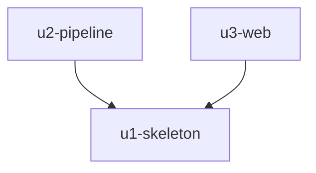

# Unit Dependencies

Topology only, from `unit-of-work.md` and the component dependencies in `inception/domain-design/components.md`. The build order is decided in Delivery Planning. Requirement and story references are in `inception/requirements-analysis/requirements.md` and `inception/user-stories/stories.md`.

## Dependency Graph

- **U2 (u2-pipeline) depends on U1 (u1-skeleton):** it extends the skeleton's DumpSource, ListeningDataPrep, SimilarityTraining, SimilarityIndex and ArtistCatalog code to the full rules and full-size data.
- **U3 (u3-web) depends on U1 (u1-skeleton):** it extends the skeleton's WebApp and calls the ArtistCatalog and SimilarityIndex interfaces the skeleton defines.
- U2 and U3 do not depend on each other.


<!-- Text fallback: u2-pipeline depends on u1-skeleton; u3-web depends on u1-skeleton; u2 and u3 are independent of each other. -->

## Walking Skeleton

U1 is the first unit in every valid order and the integrated slice. It runs on its own: sample data goes through prep, training and the index to one similar-artist answer from the web endpoint, with no code from U2 or U3.

## Integration Points

| From | To | Integration |
|------|----|------------|
| U2 | U1 | Same component interfaces; U2 fills in the full behaviour behind them |
| U3 | U1 | Calls ArtistCatalog (search, details) and SimilarityIndex (neighbours, scores) through the interfaces U1 defines |
| U3 | U2 | Indirect only: at run time U3 reads the files U2's commands build; no code dependency |

## Parallel Development

After U1, U2 and U3 can be built in either order or side by side. U3 can be tested on fixture data before U2 builds the full-size files.

```yaml
units:
  - name: u1-skeleton
    kind: service
    depends_on: []
  - name: u2-pipeline
    kind: library
    depends_on: [u1-skeleton]
  - name: u3-web
    kind: service
    depends_on: [u1-skeleton]
```
